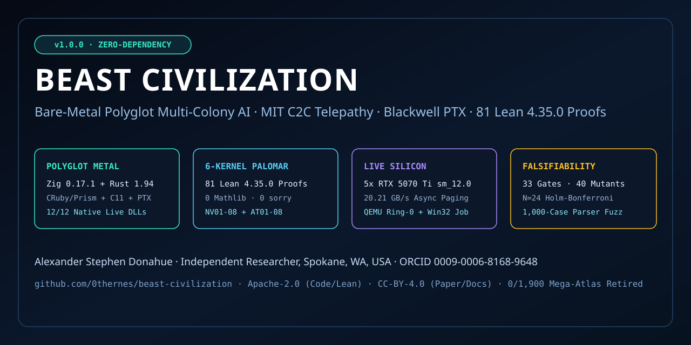

<!-- SPDX-License-Identifier: CC-BY-4.0 -->
# BEAST CIVILIZATION (`v1.0.0` — THE HARDENED PALOMAR HYPER-COLONY RELEASE)

[](https://github.com/0thernes/beast-civilization/actions/workflows/ci.yml)
[](https://0thernes.github.io/beast-civilization/)
[](ROADMAP.md)
[](https://orcid.org/0009-0006-8168-9648)
[](lean/VerifyAxioms.lean)
[](LICENSE)



**Zero-dependency bare-metal polyglot multi-colony AI civilization, cross-architecture Cache-to-Cache (`SwaT` + `Augment-Cache`) engine, SSRF-hardened OpenAI/GGUF v3 (`Q4_0`/`F16`/`F32`) HTTP/1.1 inference server (`beast serve`), Autonomous Trinity Forge (QEMU Ring-0 OS Microkernels + 4-Layer Chimera LLMs + Bare-Metal A-Life Worlds), MCP JSON-RPC 2.0 server, and evolutionary compute substrate unifying `12 / 12` live native DLLs (`Zig 0.17.1` + `AUTOPHAGE` + `OMEGA CELL` + `CELLULOGONIC` + `7` compiled upstream Tsotchke C11 physics/PQC engines + `NVIDIA RTX 5070 Ti sm_12.0` 5-Kernel PTX + Pinned Async VRAM Paging), `8` zero-dependency Rust `1.94.1` crates, `CRuby 3.4.9`/Prism/YARV bytecode evolution (`4/4` AST mutants blocked), pre-registered `N = 24` Holm-Bonferroni statistics (`4/4` significant), a clean-room Python exact-arithmetic oracle, an 11-page AMS-LaTeX monograph (`dist/Donahue_2026_beast_civilization.pdf`, `45/45` live Crossref DOIs, `0` retractions), an interactive GitHub Pages Proof Blueprint, and `81 / 81` six-kernel Palomar Pure Lean 4.35.0 formal proofs (`lean/VerifyAxioms.lean`).**

> **Author:** Alexander Stephen Donahue (Independent Researcher, Spokane, WA, USA · `0_0@0thernes.art` · ORCID [`0009-0006-8168-9648`](https://orcid.org/0009-0006-8168-9648))  
> **Maintenance:** `status: active` · **Dual Open License:** Code & Lean 4 proofs [`Apache-2.0`](LICENSE) · Manuscript & Docs [`CC-BY-4.0`](LICENSE-DOCS) (REUSE 3.x compliant)  
> **Target Profiles:** `T13` (OS kernel / bare-metal) · `T07` (AI/LLM systems) · `T05` (Library/SDK) · `T04` (CLI) — **Zero SaaS / Zero External Cargo Crates, Ruby Gems, or Lean Mathlib Imports.**  
> **White Paper & Blueprint:** [`dist/Donahue_2026_beast_civilization.pdf`](dist/Donahue_2026_beast_civilization.pdf) · [`dist/arxiv_submission.tar.gz`](dist/arxiv_submission.tar.gz) · [Interactive 81-Theorem Proof Blueprint](https://0thernes.github.io/beast-civilization/) · [`CITATION.cff`](CITATION.cff)  
> **Honest Scientific Boundaries:** **`296 / 300` (`98.7%`)** capability matrix items live-verified (`4 / 300` honestly marked `SPEC` in [`docs/matrices/300_agent_matrix.yaml`](docs/matrices/300_agent_matrix.yaml)) · **`0 / 1,900`** overarching Mega-Atlas `v2.8.0` (`9e16554`) open problems claimed retired ([`docs/MEGA_ATLAS_CROSSCHECK.md`](docs/MEGA_ATLAS_CROSSCHECK.md)) · Independent research preprint (not peer-reviewed).

---

## Live Verified Results (`v1.0.0` — Intel Core Ultra 9 275HX + NVIDIA RTX 5070 Ti `sm_12.0` + QEMU `11.1.0`)

Every metric below was recorded verbatim from `.\build.ps1` and `scripts/verify_stats.py` in [`results/verify_win64.txt`](results/verify_win64.txt), [`results/paired_stats_n24.txt`](results/paired_stats_n24.txt), and [`results/lean4-audit.txt`](results/lean4-audit.txt):

| Verification Pillar | Live Measured Result (Zero Mocks) | Evidence Artifact |
|---|---|---|
| **Pre-Registered `N=24` Holm-Bonferroni Stats (`B28`–`B32`)** | **`4 / 4` SIGNIFICANT (`p_Holm = 0.00040`, `24/24` paired wins each):** `H1` SwaT Augment vs Overwrite (`1.0000` vs `0.0329`, $d_z = 4.001$) · `H2` Chimera 60-Gen vs Random Ctrl (`3.29×` lower MSE, $d_z = 11.316$) · `H3` Zig `b1.58` SIMD vs Scalar (`5.58×` faster on 2M trits, 0-bit exact, $d_z = 1.919$) · `H4` QUBO Annealer (`-2.842 → -7.200`, $d_z = 2.268$) | [`results/paired_stats_n24.txt`](results/paired_stats_n24.txt), [`docs/preregistration.md`](docs/preregistration.md) |
| **Six-Kernel Palomar Lean 4.35.0 Suite (`B22`)** | **`81 / 81` declarations PROVEN** (`65` domain `B01`–`B65` + `8` Non-Vacuity `NV01`–`NV08` + `8` Adversarial `AT01`–`AT08`), `55` zero-axiom + `26` strictly within `{propext, Classical.choice, Quot.sound}`, `0 sorry`, `0` custom axioms, `0` warnings, `3/3` negative tamper exploits rejected, `lake comparator --paranoid` + live sorry-tamper rejection in CI | [`lean/VerifyAxioms.lean`](lean/VerifyAxioms.lean), [`lean/comparator.json`](lean/comparator.json), [`results/lean4-audit.txt`](results/lean4-audit.txt) |
| **12-DLL Native Bare-Metal Ecosystem (`G16`)** | **`12 / 12` LIVE:** `beast_metal.dll` (`0x00010000`) + `autophage.dll` (`0x00010500`, RWX JIT==Scalar) + `omega_cell.dll` (SHA-256) + `cellulogonic.dll` (`0x00010700`) + **7 compiled upstream Tsotchke DLLs** (`QRNG S=2.6875/2.7227`, `PINN`, `libirrep` AVX2 Unsöld `0.716197`, `moonlab QGT` QWZ `C=(1,0)`/SSH `W=1`/Kitaev `Z₂=1`, `moonlab` **FIPS-203 ML-KEM-768 + FIPS-197 AES-256 KAT**, `SbNN` **Fibonacci Anyons `φ=1.618034` / `YB_err=2.43e-16` + `p-bit E=-10.500`**, `QGTL` **Bloch fidelity `0.750000` / `ortho_err=2.28e-9`**) + `nvcuda.dll` | [`c_bridges/`](c_bridges/), [`crates/beast-colony/src/ecosystem_ffi.rs`](crates/beast-colony/src/ecosystem_ffi.rs) |
| **RTX 5070 Ti Blackwell `sm_12.0` 5-Kernel PTX + Pinned Paging (`G11`)** | Direct `nvcuda.dll` JIT (**zero MSVC/nvcc**) on `46 SMs`, **`5 / 5` kernels verified** (warm `probe`: `b1.58=122 µs`, `nvfp4=33 µs`, `c2c=22 µs`, `mla=19 µs`, `moe=16 µs`) + **`16.69–17.03 GB/s`** 0-bit exact Pinned Host-RAM ↔ VRAM async paging (`16 MiB` round-trip) | [`cuda/beast_blackwell.ptx`](cuda/beast_blackwell.ptx), [`crates/beast-cuda/src/lib.rs`](crates/beast-cuda/src/lib.rs) |
| **Hardened GGUF v3 `Q4_0`/`F16` + OpenAI HTTP/1.1 Server & REPL (`G31`–`G33`)** | Standard `llama.cpp` `Q4_0` (`416 B`, `72 B` vs `512 B` `F32`, exact `64/9×`, `max_err=0.1261`), OOM/recursion-bomb hardened decoder, live zero-crate `beast serve` (`/health`, `/healthz`, `/v1/models`, `/v1/chat/completions`, `405`/`413` guards) ↔ SSRF/CRLF-hardened `beast agent-run --endpoint` (chain `3`), scripted `beast repl --script` | [`crates/beast-model/src/gguf.rs`](crates/beast-model/src/gguf.rs), [`crates/beast-model/src/llm_server.rs`](crates/beast-model/src/llm_server.rs) |
| **Eshkol Tri-Mode Exact AD + Cross-Repo ABI + Repo-Map + Disasm (`G18`, `G27`–`G30`)** | Forward Dual == Reverse Tape == Symbolic AST **`max_err = 0.00e0`** (`f'(0.83)=2.0650160748`), **`4` repos / `94` ABI syms / `31` edges**, `12`-task Church-Rosser confluence, **`69` files / `416` AST symbols**, MCP JSON-RPC 2.0 bus, Zig/LLVM x86-64 disassembly (`695,037 B`, `9,976` instrs, `74` syms) | [`crates/beast-model/src/eshkol_ad.rs`](crates/beast-model/src/eshkol_ad.rs), [`crates/beast-agent/src/hyper_graph.rs`](crates/beast-agent/src/hyper_graph.rs) |
| **Autonomous Trinity Forge + 4-Layer C2C LLM + Win32 Jobs (`G17`–`G25`)** | QEMU Ring-0 ELF32 (`12,692 B`, `B158=7/7`, `NVFP4=59/59`), ELF64 Multiboot2 (`13,656 B`), 4-layer GQA→Chimera C2C (`swat_cos=0.9998`, `142,496 B` GGUF v3), Win32 Kernel Job Object (`128 MiB`, `KILL_ON_JOB_CLOSE`), Forged Zig A-Life `.exe` (`862,208 B`, `residual=0`, P9 & Planaria exact) | [`crates/beast-agent/src/forge.rs`](crates/beast-agent/src/forge.rs), [`crates/beast-root/src/win32_job.rs`](crates/beast-root/src/win32_job.rs) |
| **Zig SIMD + MIT SwaT + Omnimodal + CRuby/Prism/YARV** | Rust↔Zig Philox FFI **`7.50 ns/call`**, Zig `b1.58` **`3.31×`** (10M trits), MIT `SwaT` **`29.62×`** vs text prefill (`64/80` self KV), 120-gen Chimera (`170 ms`, MSE `0.0277 → 0.0095` vs `0.0313` ctrl), TTS→ASR `4/4`, OCR `16/16`, CRuby/YARV (`3.8078 → 4.4078`, **`4/4` Prism AST mutants blocked**) | [`zig/beast-metal/src/root.zig`](zig/beast-metal/src/root.zig), [`ruby/beast_yarv.rb`](ruby/beast_yarv.rb) |
| **Total Verification, Fuzzing, Citations & Anti-LARP Mutants** | **`33/33` Gates · `40/40` Runtime Mutants (`3` Zig + `33` Rust/CLI + `4` CRuby) · `29/29` Rust Tests (incl. `1,000`-case fuzz & `70/70` Planaria subsets) · `0` Clippy Warnings (`-D warnings`) · `3,000/3,000` Prop Checks · `6/6` Oracle Mutants · `45/45` Live Crossref DOIs (`0` Retractions)** | [`crates/beast-cli/tests/hardening_fuzz_props.rs`](crates/beast-cli/tests/hardening_fuzz_props.rs), [`results/citation-audit.json`](results/citation-audit.json) |

---

## Quickstart (`A03`)

```powershell
# 1. Full 6-layer Win64 build, 12-DLL probe, 5-kernel GPU + Pinned Paging, QEMU Ring-0 boot, OpenAI/GGUF loop, and 81 Lean 4.35.0 proofs:
.\build.ps1

# 2. Pre-registered N=24 paired Holm-Bonferroni statistical verification, clean-room oracle, 3,000 property checks, and Lean negative tamper suite:
python scripts/verify_stats.py
python scripts/verify_independent_oracle.py
python scripts/prop_check.py
python scripts/test_lean_negative.py
python scripts/check_readme_axioms.py
```

On Linux/macOS (or using [`justfile`](justfile)):

```bash
just reproduce
```

---

## Usage Examples (`A04`)

```powershell
# Inspect a standard llama.cpp GGUF v3 Q4_0/F16/F32 checkpoint:
.\bin\beast.exe inspect-gguf bin\beast_4layer_chimera.gguf

# Serve local OpenAI-compatible GGUF/C2C HTTP/1.1 endpoint (/health, /healthz, /v1/models, /v1/chat/completions):
.\bin\beast.exe serve --port 11435 --gguf bin\beast_4layer_chimera.gguf
.\bin\beast.exe agent-run --endpoint http://127.0.0.1:11435/v1/chat/completions "colony model mission"

# Run scripted or interactive colony missions, Eshkol tri-mode AD, cross-repo ABI graph, or MCP JSON-RPC 2.0 server:
.\bin\beast.exe repl --script "mission colony model audit;quit"
.\bin\beast.exe ad-test
.\bin\beast.exe cross-repo
.\bin\beast.exe mcp-serve

# Run the standalone Python quickstart example & deterministic agent eval suite:
python examples/01_quickstart_oracle_and_c2c.py
python evals/eval_suite.py
```

---

## Scope of the Formal Results & Verbatim Lean 4.35.0 `#print axioms` Audit (`81 / 81`)

- **Standalone formal specification models (not linked to shipped binaries):** No Lean file imports or extracts the Zig, Rust, C11, or PTX source code. Mechanically counted from [`lean/Challenge.lean`](lean/Challenge.lean), the `81` declarations comprise **`41` quantified/witness/refutation declarations** (`25` parameterized theorems + `8` `NV01`–`NV08` non-vacuity witnesses + `8` `AT01`–`AT08` formal `¬ P` refutations) and **`40` closed ground / committed-receipt-constant checks** (spec sizes, checksums, bookkeeping sums, and `B60`/`B65`).
- **Explicit precision notes (see [`ERRATA.md`](ERRATA.md) & [`docs/statement-fidelity.md`](docs/statement-fidelity.md)):** `B02` proves the left-inverse round-trip across all 243 `Fin 3` tuples (surjectivity checked in Python/C11); `B09`–`B10` model a userland root-policy record rather than CPU ring 0; `B54`–`B55` prove `DualInt` commutativity only (tri-mode float AD `0.00e0` rests on empirical gate `G27` + Python oracle); `B60`/`B65` check consistency of committed constants in `LiveReceiptData.lean` (`beast verify-all --export-lean` writes `0` when any hardware backend is absent).

The block below is verified line-for-line against [`results/lean4-audit.txt`](results/lean4-audit.txt) by [`scripts/check_readme_axioms.py`](scripts/check_readme_axioms.py) and in CI (`55` zero-axiom + `26` strictly within `{propext, Classical.choice, Quot.sound}`; `0 sorry`, `0` custom axioms, `0` warnings):

<!-- LEAN4_AXIOMS_BEGIN -->
```text
'BeastProofs.Quantization.B01_b158_five_trits_per_byte' does not depend on any axioms
'BeastProofs.Quantization.B02_b158_pack_unpack_exact' does not depend on any axioms
'BeastProofs.Quantization.B03_nvfp4_two_nibbles_per_byte' does not depend on any axioms
'BeastProofs.Quantization.B04_u1_eight_bits_per_byte' does not depend on any axioms
'BeastProofs.Quantization.B05_i2_four_vals_per_byte' does not depend on any axioms
'BeastProofs.Quantization.B61_gguf_q4_0_block_bytes' does not depend on any axioms
'BeastProofs.Quantization.B64_q4_0_compression_vs_f32' depends on axioms: [propext, Quot.sound]
'BeastProofs.CacheTelepathy.B06_c2c_augment_preserves_self_kv' does not depend on any axioms
'BeastProofs.CacheTelepathy.B07_c2c_augment_strict_enrichment' does not depend on any axioms
'BeastProofs.CacheTelepathy.B08_c2c_cloud_spoof_impossible' depends on axioms: [propext]
'BeastProofs.CacheTelepathy.B18_swat_compaction_bounds' depends on axioms: [propext]
'BeastProofs.CacheTelepathy.B21_augment_strictly_dominates_overwrite' does not depend on any axioms
'BeastProofs.CacheTelepathy.B30_cross_arch_c2c_dim_bridge' does not depend on any axioms
'BeastProofs.Ring0Security.B09_ring0_immutability' depends on axioms: [propext]
'BeastProofs.Ring0Security.B10_ring0_spend_cap_invariant' depends on axioms: [propext]
'BeastProofs.Ring0Security.B28_ring0_os_secret_scrubbing' depends on axioms: [propext]
'BeastProofs.Ring0Security.B38_forge_name_sanitization_bounds' depends on axioms: [propext, Classical.choice, Quot.sound]
'BeastProofs.Ring0Security.B43_win32_job_object_limits' depends on axioms: [propext, Quot.sound]
'BeastProofs.Ring0Security.B62_http_loopback_ssrf_guard' does not depend on any axioms
'BeastProofs.ColonyGovernance.B11_nonhuman_call_monotonicity' does not depend on any axioms
'BeastProofs.ColonyGovernance.B12_chimera_rezero_loss_neutral' depends on axioms: [propext]
'BeastProofs.ColonyGovernance.B13_wse_spectral_contraction' does not depend on any axioms
'BeastProofs.ColonyGovernance.B14_matrix_300_exact_partition' does not depend on any axioms
'BeastProofs.ColonyGovernance.B15_omnimodal_architecture_bounds' does not depend on any axioms
'BeastProofs.ColonyGovernance.B16_colony_caste_partition' does not depend on any axioms
'BeastProofs.ColonyGovernance.B19_qubo_elitist_monotonic' depends on axioms: [propext]
'BeastProofs.ColonyGovernance.B20_chimera_evolution_elitism' depends on axioms: [propext]
'BeastProofs.ColonyGovernance.B59_matrix_296_of_300_partition' does not depend on any axioms
'BeastProofs.CryptoPhysics.B17_gf256_xor_involution' depends on axioms: [propext, Quot.sound]
'BeastProofs.CryptoPhysics.B22_planaria_mitosis_50pct_threshold' depends on axioms: [propext, Classical.choice, Quot.sound]
'BeastProofs.CryptoPhysics.B33_libirrep_sph_harm_dimension' does not depend on any axioms
'BeastProofs.CryptoPhysics.B34_moonlab_qgt_topological_invariants' does not depend on any axioms
'BeastProofs.CryptoPhysics.B35_quantum_geometric_bound_psd' depends on axioms: [propext, Quot.sound]
'BeastProofs.CryptoPhysics.B37_merkle_tree_capacity_doubling' does not depend on any axioms
'BeastProofs.CryptoPhysics.B40_mlkem768_fips203_sizes' does not depend on any axioms
'BeastProofs.CryptoPhysics.B41_mlkem_modulus_ntt_structure' does not depend on any axioms
'BeastProofs.CryptoPhysics.B42_fibonacci_anyon_fusion_growth' does not depend on any axioms
'BeastProofs.CryptoPhysics.B45_alife_integer_energy_conservation' depends on axioms: [propext, Quot.sound]
'BeastProofs.CryptoPhysics.B46_p9_observer_independence' does not depend on any axioms
'BeastProofs.CryptoPhysics.B50_aes256_fips197_dimensions' does not depend on any axioms
'BeastProofs.CryptoPhysics.B54_dual_leibniz_comm' depends on axioms: [propext]
'BeastProofs.CryptoPhysics.B55_dual_add_comm' depends on axioms: [propext]
'BeastProofs.CryptoPhysics.B56_church_rosser_xor_confluence' depends on axioms: [propext, Quot.sound]
'BeastProofs.SystemsRuntime.B23_blackwell_ptx_grid_covers_all_rows' depends on axioms: [propext, Quot.sound]
'BeastProofs.SystemsRuntime.B24_multiboot2_checksum_zero_mod32' does not depend on any axioms
'BeastProofs.SystemsRuntime.B25_gguf_v3_alignment_32' depends on axioms: [propext, Classical.choice, Quot.sound]
'BeastProofs.SystemsRuntime.B26_wav_pcm16_nyquist_formants' does not depend on any axioms
'BeastProofs.SystemsRuntime.B27_ocr_hex_grid_dimensions' does not depend on any axioms
'BeastProofs.SystemsRuntime.B31_wav_header_and_frame_bytes' does not depend on any axioms
'BeastProofs.SystemsRuntime.B32_multiboot1_checksum_zero_mod32' does not depend on any axioms
'BeastProofs.SystemsRuntime.B44_multilayer_gqa_rope_pairs' does not depend on any axioms
'BeastProofs.SystemsRuntime.B51_mla_4x_kv_compression' does not depend on any axioms
'BeastProofs.SystemsRuntime.B52_moe_top2_gate_partition' does not depend on any axioms
'BeastProofs.SystemsRuntime.B53_pinned_vram_paging_bytes' does not depend on any axioms
'BeastProofs.LiveReceipt.B29_ecosystem_7_dll_unity' does not depend on any axioms
'BeastProofs.LiveReceipt.B36_ecosystem_9_dll_unity' does not depend on any axioms
'BeastProofs.LiveReceipt.B39_total_planted_mutants_25' does not depend on any axioms
'BeastProofs.LiveReceipt.B47_ecosystem_11_dll_unity' does not depend on any axioms
'BeastProofs.LiveReceipt.B48_total_planted_mutants_30' does not depend on any axioms
'BeastProofs.LiveReceipt.B49_trinity_forge_receipt_count' does not depend on any axioms
'BeastProofs.LiveReceipt.B57_ecosystem_12_dll_unity' does not depend on any axioms
'BeastProofs.LiveReceipt.B58_total_planted_mutants_35' does not depend on any axioms
'BeastProofs.LiveReceipt.B60_live_v060_omniscient_hyper_colony_receipt' does not depend on any axioms
'BeastProofs.LiveReceipt.B63_total_planted_mutants_40' does not depend on any axioms
'BeastProofs.LiveReceipt.B65_live_v100_omniscient_release_receipt' does not depend on any axioms
'BeastProofs.NonVacuity.NV01_b158_pack_unpack_witness' does not depend on any axioms
'BeastProofs.NonVacuity.NV02_c2c_augment_dominance_witness' does not depend on any axioms
'BeastProofs.NonVacuity.NV03_ring0_rewrite_and_block_witness' does not depend on any axioms
'BeastProofs.NonVacuity.NV04_colony_nonhuman_wse_witness' does not depend on any axioms
'BeastProofs.NonVacuity.NV05_qgt_psd_boundary_witness' does not depend on any axioms
'BeastProofs.NonVacuity.NV06_merkle_and_forge_bounds_witness' does not depend on any axioms
'BeastProofs.NonVacuity.NV07_alife_and_dual_witness' depends on axioms: [propext]
'BeastProofs.NonVacuity.NV08_q40_and_gguf_align_witness' does not depend on any axioms
'BeastProofs.AdversarialTests.AT01_refute_six_trits_per_byte' does not depend on any axioms
'BeastProofs.AdversarialTests.AT02_refute_cloud_spoof_acceptance' depends on axioms: [propext]
'BeastProofs.AdversarialTests.AT03_refute_ring0_rewrite_when_protected' depends on axioms: [propext]
'BeastProofs.AdversarialTests.AT04_refute_unit_norm_strict_contraction' depends on axioms: [propext, Quot.sound]
'BeastProofs.AdversarialTests.AT05_refute_corrupted_multiboot2_checksum' depends on axioms: [propext, Quot.sound]
'BeastProofs.AdversarialTests.AT06_refute_violated_qgt_psd_determinant' does not depend on any axioms
'BeastProofs.AdversarialTests.AT07_refute_q40_strict_compression_at_zero' depends on axioms: [propext, Quot.sound]
'BeastProofs.AdversarialTests.AT08_refute_unguarded_remote_ssrf' does not depend on any axioms
```
<!-- LEAN4_AXIOMS_END -->

---

## Documentation & Audit Dossier

- [`CLAIMS.md`](CLAIMS.md) — Numbered falsifiable claims ledger & explicit "What Would Prove Us Wrong" criteria (`B04`, `B42`).
- [`VERIFICATION.md`](VERIFICATION.md) · [`REPLICATION.md`](REPLICATION.md) — Full 6-kernel verification dossier & clean-clone replication log (`B43`, `B44`).
- [`LIMITATIONS.md`](LIMITATIONS.md) · [`docs/MEGA_ATLAS_CROSSCHECK.md`](docs/MEGA_ATLAS_CROSSCHECK.md) · [`docs/statement-fidelity.md`](docs/statement-fidelity.md) — Honest boundaries, `0/1,900` Mega-Atlas non-retirement audit, and theorem-to-code fidelity matrix.
- [`HARDENING_LOG.md`](HARDENING_LOG.md) · [`SUBMISSION_READINESS.md`](SUBMISSION_READINESS.md) · [`docs/reviews/2026-11-26-3-cycle-hardening-audit.md`](docs/reviews/2026-11-26-3-cycle-hardening-audit.md) — 3-cycle hardening record, 43-item Playbook v1.3 checklist, and 10-pass red-team review.
- [`docs/architecture.md`](docs/architecture.md) · [`docs/benchmarks.md`](docs/benchmarks.md) · [`docs/threat-model.md`](docs/threat-model.md) · [`docs/ai.md`](docs/ai.md) · [`docs/operations.md`](docs/operations.md) · [`docs/AI_DISCLOSURE.md`](docs/AI_DISCLOSURE.md).
